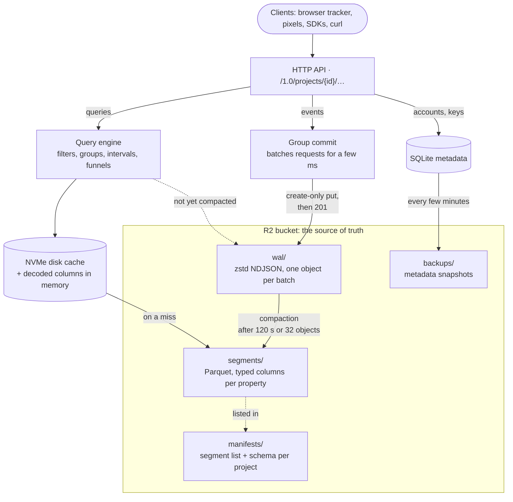

<p align="center">
  <picture>
    <source media="(prefers-color-scheme: dark)" srcset="src/web/brand/incisive-logo-dark.svg">
    
  </picture>
</p>

Event analytics on object storage. One Rust binary that takes JSON events over HTTP, stores them
durably in an S3-compatible bucket (Cloudflare R2 in production), and answers analysis queries
(counts, uniques, sums, percentiles, funnels, extractions, grouped and bucketed by time) from
columnar segments cached on local NVMe. It ships with a web app: sign-in with emailed 6-digit codes, API key management,
a tracking pixel generator, and a web analytics dashboard built on a standard pageview schema.

The HTTP API lives under `/1.0/projects/{project_id}/...`. Client libraries for Python, Ruby,
JavaScript, Go, PHP, Java and .NET are in [`sdks/`](sdks/).

## Architecture



- **Writes** are group-committed: requests arriving within a few milliseconds share one
  zstd-compressed NDJSON object per collection, written with a create-only put. A request is
  acknowledged only after its object is stored, so an acknowledged event is durable.
- **Compaction** folds WAL objects into Parquet segments. Every leaf property path becomes typed
  columns (a type tag, a number column and a string column), so mixed types, explicit nulls and
  missing properties stay distinct. The raw event is kept too, for extractions. Small segments are
  merged over time and absorbed WAL objects are deleted.
- **Manifests** (one JSON document per project) list a collection's segments, the WAL objects they
  absorbed, and the observed schema. They are updated with conditional puts (ETag match).
- **Queries** read the manifest's segments plus WAL objects not yet absorbed, project only the
  columns they need, and evaluate filters and aggregations over columnar batches. Immutable objects
  are cached on local disk (LRU) and decoded columns in memory.
- **Metadata** (users, sessions, projects, keys, saved queries) lives in SQLite, snapshotted to the
  bucket every few minutes and restored automatically when the local file is missing.
- One server writes to a given storage prefix. Run more than one writer only with separate
  prefixes.

Object layout under the configured prefix:

| Key | Contents |
|---|---|
| `wal/{project}/{collection}/{ulid}_{min_ts}_{max_ts}.ndjson.zst` | committed, not yet compacted events |
| `segments/{project}/{collection}/{ulid}.parquet` | compacted events |
| `manifests/{project}.json` | segments, absorbed WAL, schema |
| `backups/meta-latest.sqlite.zst`, `backups/meta-{date}.sqlite.zst` | metadata snapshots |

## Running

```bash
cargo build --release
./target/release/incisive --config incisive.toml serve
```

Configuration comes from defaults, then the TOML file, then `INCISIVE_*` environment variables
(`__` separates sections, e.g. `INCISIVE_STORAGE__BUCKET`). `incisive config` prints the effective
configuration. The main sections:

- `server`: `addr`, `public_url` (used in emails and snippets), `trust_forwarded_for` (take client
  IPs from `X-Forwarded-For`; enable only behind a trusted proxy), `redirect_allow_hosts`,
  `secure_cookies`.
- `storage`: `backend` (`s3` or `fs`), `bucket`, `endpoint`, `region`, `profile`, `prefix`,
  `fs_path`. Credentials come from `AWS_ACCESS_KEY_ID`/`AWS_SECRET_ACCESS_KEY` or the named profile
  in `~/.aws/credentials`; they are never written to config files.
- `cache`: disk cache `dir` and `max_disk_bytes`.
- `wal`, `compaction`: group commit window and compaction thresholds.
- `meta`: SQLite `path` and `backup_interval_secs`.
- `email`: a Resend-compatible `resend_url`, optional `api_key`, `from`, and `log_only` (print
  sign-in codes instead of sending them, for development).
- `limits`: event and request sizes, batch size, per-project write and query rates, query
  concurrency and timeout, and caps on extractions, funnel actors, groups, intervals and scans.
- `geo.db_path`: an optional MaxMind-format city database for IP geolocation (country, region,
  city, coordinates). The dev deployment uses DB-IP City Lite, refreshed monthly by
  `scripts/update_geo.sh` and `deploy/incisive-geo.timer`; its license (CC BY 4.0) requires the
  "IP Geolocation by DB-IP" credit the dashboard shows.

Other commands: `create-project NAME [--owner EMAIL]` prints a new project's keys,
`create-account-key NAME --owner EMAIL` prints a new account master key, `compact` folds
all pending WAL now, `backup` snapshots metadata now.

`deploy/` holds the dev deployment: config, systemd unit, and the Caddyfile that routes the
share port by host name.

## API

Project routes are under `/1.0/projects/{project_id}`, account routes under `/1.0/account`. Send
the key in the `Authorization` header (or as `api_key`).

| Route | |
|---|---|
| `POST /events/{collection}` | one event (`201 {"created": true}`); a JSON list is treated as a batch |
| `POST /events` | batch: `{collection: [events]}`, answered per event |
| `GET /events/{collection}?data=BASE64` | write from a URL: answers JSON, a 1x1 GIF (`c=` or an image `Accept`), JSONP (`jsonp`/`callback`), or a redirect to an allowed host (`redirect`) |
| `GET /events`, `GET /events/{collection}`, `GET /events/{c}/properties/{p}` | schema discovery |
| `DELETE /events/{collection}` | delete by `filters`, `timeframe`, `timezone`; any other parameter is rejected so a misspelled filter cannot delete everything |
| `GET\|POST /queries/{analysis}` | `count`, `count_unique`, `sum`, `average`, `minimum`, `maximum`, `median`, `percentile`, `select_unique`, `extraction`, `funnel`, `multi_analysis` |
| `/queries/saved[/{name}[/result]]` | saved queries (also under `/queries/cached`) |
| `/keys[/{key}[/revoke\|/unrevoke]]` | key management |
| `GET /`, `POST /` | project details; `POST {"name": ...}` renames (master key) |
| `/datasets` | not supported (501) |

Events carry a reserved metadata object holding `timestamp` (defaults to receipt time),
`created_at`, `id` and data enrichment add-ons (URL, referrer, user agent, date-time and IP-to-geo
parsers). A string value equal to the client IP or user agent placeholder is replaced by the
server.

### Keys and permissions

Keys look like `sk_incisive_` followed by 20 characters, and are stored hashed. Each project starts
with three:

- **Master**: everything, including deletes, saved query changes and key management. Its secret
  is retained so it can verify legacy encrypted scoped keys minted by client libraries.
- **Read**: `queries`, `saved_queries`, `cached_queries`, `schema`.
- **Write**: `writes`. Write-only keys are public by nature (they ship in web pages), so their
  secret stays visible in the app.

Custom keys combine `writes`, `queries`, `saved_queries`, `cached_queries`, `schema` and
`datasets`, with options: `writes.autofill` (properties stamped onto every event, overriding the
client), `queries.filters` (added to every query, for per-customer dashboards), and
`saved_queries`/`cached_queries` `allowed`/`blocked` name lists.

### Account master keys

Account master keys look like `ak_incisive_` followed by 32 characters. Each belongs to a user,
is stored hashed and is shown only once, at creation (web app: **Account keys**, or the
`create-account-key` command). It works as the master key of every project its user belongs to,
including projects created later, and it can use the account routes:

| Route | |
|---|---|
| `GET /1.0/account` | the user's email and projects |
| `GET /1.0/account/projects` | list projects |
| `POST /1.0/account/projects` | `{"name": ...}` creates a project; answers with its master, read and write keys |
| `GET\|POST /1.0/account/keys` | list account keys (no secrets) or create one (`{"name": ...}`) |
| `DELETE /1.0/account/keys/{id}` | delete an account key |

Project keys never work on account routes, and an account key gets nothing on projects its user
does not belong to.

## Web analytics

The browser tracker is `src/web/tracker.js`. `scripts/publish_tracker.sh` uploads it to a public
static bucket as `js/incisive.js` (5-minute cache) and `js/incisive-VERSION.js` (immutable), and
`server.tracker_url` points the install snippet there. The server also serves it at
`/js/incisive.js` for self-hosting.

```html
<script defer src="https://STATIC_HOST/js/incisive.js"
  data-project="PROJECT_ID" data-key="WRITE_KEY" data-host="https://API_HOST"></script>
```

Or start it with one call:

```js
incisive.trackAll({
  project: "PROJECT_ID", key: "WRITE_KEY", host: "https://API_HOST",
  clicks: true, forms: true, engagement: true, views: true, errors: false,
  // Optional: properties added to every event. These are placeholders; a function is called on each event.
  // properties: { app: { version: "2.3.1" }, cart: { items: () => window.cart.length } },
});
```

`properties` are joined into every event; functions are called per event with
`{collection, event}`. The page load is always recorded once tracking starts, even if the visitor
leaves before the page finishes loading. In script-tag mode, `data-auto-track` takes `false` or a
comma list of the flags.

It keeps a first-party visitor ID, starts a session after 30 minutes of inactivity, at midnight
UTC, or on arrival with new campaign parameters, and sends, over `sendBeacon` (falling back to
`fetch` and then an image):

| Collection | When |
|---|---|
| `web_session` | once per session |
| `web_pageview` | every page, including single-page-app navigations |
| `web_click` | clicks on links, buttons and `data-track` elements, with outbound and download detection |
| `web_form_submit` | form submissions (never field values) |
| `web_engagement` | when a page view ends: engaged seconds, total seconds, max scroll depth |
| `web_element_view` | `data-track-view` elements scrolling into view |
| `web_error` | uncaught errors (off by default) |

All use the standard schema, which is deliberately denormalized: every event repeats its
session's landing page, external referrer, UTM parameters, ad click ID and derived channel, plus
the visitor's identity, device, browser, language and timezone, so any question is one query on
one collection. The server fills `ip_address` and `user_agent.raw` when absent and derives URL
parts, referrer source and medium, the default channel grouping (Direct, Organic Search, Paid
Search, Organic Social, Paid Social, Email, Referral, Affiliates, Display), browser, OS, device
type, bot detection, geo (with a database) and local time. Client values always win over derived
ones. The full field list is on the Schema page of the app and in `src/standard.rs`.

`incisive.track(collection, props)` sends custom events with the same context;
`incisive.identify(userId, traits)` adds `visitor.user_id` and `visitor.traits` from then on;
`incisive.extend(props)` adds properties to every later event.

## Tests

```bash
cargo test                                   # unit, query fixture, HTTP API
INCISIVE_SMOKE_CONFIG=deploy/incisive.dev.toml cargo test --test fixture -- --ignored   # against the bucket
```

- `tests/data/fixture.json`: 44 hand-computed queries (mixed types, null versus missing, DST,
  filters, groups, intervals, funnels, extraction), run on fresh WAL, after compaction, and after
  reopening the store.
- `tests/api.rs`: every write transport, permissions and project isolation, queries over GET and
  POST, saved queries, strict deletes, the keys API, scoped keys, standard collections.
- `tests/data/scoped_*.json`: encrypted scoped key vectors produced by the upstream libraries.
- `tests/js/tracker_e2e.cjs`: runs the served tracker in jsdom through several visits against a
  running server and checks the stored sessions, pageviews, clicks, forms, engagement, `trackAll` properties and
  derived properties.
- `sdks/test-all.sh`: runs every SDK's test suite (unit tests, plus integration tests against a
  running server when `INCISIVE_BASE_URL` and the key variables are set).
- `scripts/seed_demo.py` sends 30 days of synthetic traffic, for trying the dashboard.
