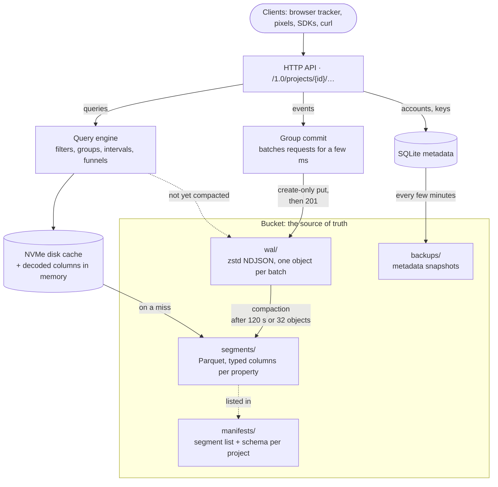

# How Incisive works

Events go to a write-ahead log in your bucket, are compacted into Parquet, and are queried
column by column with a local disk cache in front.




- **Writes** are group-committed: requests arriving within a few milliseconds share one
  zstd-compressed NDJSON object per collection, written with a create-only put. A request is
  acknowledged only after its object is stored, so an acknowledged event is durable.
- **Compaction** folds WAL objects into Parquet segments. Every leaf property path becomes typed
  columns (a type tag, a number column and a string column), so mixed types, explicit nulls and
  missing properties stay distinct. The raw event is kept too, for extractions. Small segments are
  merged over time and absorbed WAL objects are deleted.
- **Manifests** (one JSON document per project) list a collection's segments, the WAL objects they
  absorbed, and the observed schema. They are updated with conditional puts (ETag match).
- **Queries** read the manifest's segments plus WAL objects not yet absorbed, project only the
  columns they need, and evaluate filters and aggregations over columnar batches. Immutable objects
  are cached on local disk (LRU) and decoded columns in memory.
- **Metadata** (users, sessions, projects, keys, saved queries) lives in SQLite, snapshotted to the
  bucket every few minutes and restored automatically when the local file is missing.
- One server writes to a given storage prefix. Run more than one writer only with separate
  prefixes.

Object layout under the configured prefix:

| Key | Contents |
|---|---|
| `wal/{project}/{collection}/{ulid}_{min_ts}_{max_ts}.ndjson.zst` | committed, not yet compacted events |
| `segments/{project}/{collection}/{ulid}.parquet` | compacted events |
| `manifests/{project}.json` | segments, absorbed WAL, schema |
| `backups/meta-latest.sqlite.zst`, `backups/meta-{date}.sqlite.zst` | metadata snapshots |

## Tests

```bash
cargo test                                   # unit, query fixture, HTTP API
INCISIVE_SMOKE_CONFIG=incisive.toml cargo test --test fixture -- --ignored   # against your bucket
```

- `tests/data/fixture.json`: 44 hand-computed queries (mixed types, null versus missing, DST,
  filters, groups, intervals, funnels, extraction), run on fresh WAL, after compaction, and after
  reopening the store.
- `tests/api.rs`: every write transport, permissions and project isolation, queries over GET and
  POST, saved queries, strict deletes, the keys API, scoped keys, standard collections.
- `tests/data/scoped_*.json`: encrypted scoped key vectors produced by the upstream libraries.
- `tests/js/tracker_e2e.cjs`: runs the served tracker in jsdom through several visits against a
  running server and checks the stored sessions, pageviews, clicks, forms, engagement, `trackAll` properties and
  derived properties.
- `sdks/test-all.sh`: runs every SDK's test suite (unit tests, plus integration tests against a
  running server when `INCISIVE_BASE_URL` and the key variables are set).
- `scripts/seed_demo.py` sends 30 days of synthetic traffic, for trying the dashboard.
